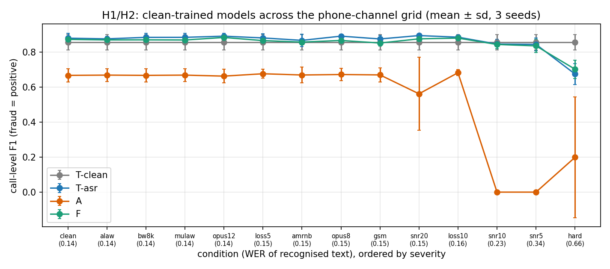
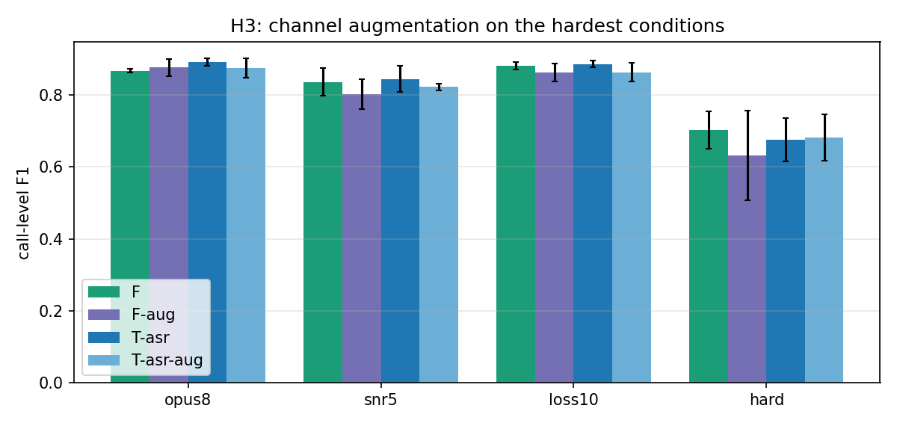
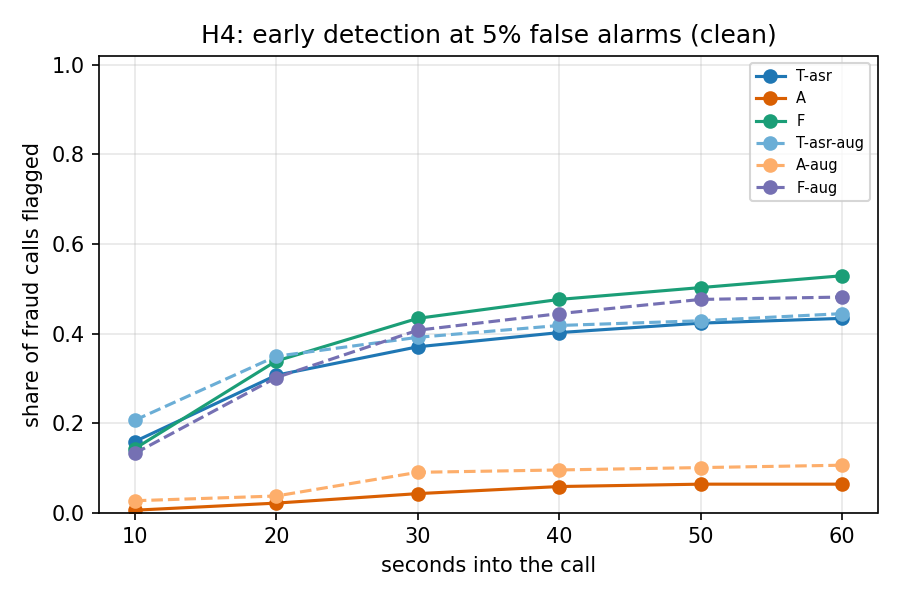
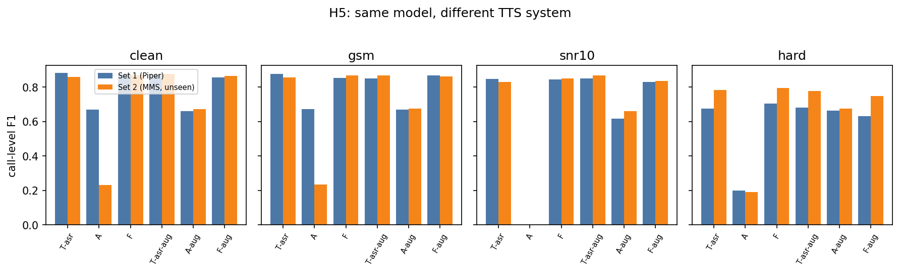

# Robust Fraud-Call Detection on Indian Phone Speech

**Required limitation.** The system is trained and evaluated on synthetic speech generated from dataset transcripts, so results may not transfer to real calls.

## Abstract
Published Indian fraud-call detectors work on clean text transcripts. Real calls arrive as compressed, noisy phone audio that speech recognition turns into imperfect text. We measure how much that hurts and whether an acoustic branch recovers the loss. From 800 conversations of ICFD-31k (balanced fraud/normal, split by `session_id`) we synthesize call audio with a text-to-speech (TTS) model, degrade it through 14 simulated phone-channel conditions (8 kHz, G.711, GSM, AMR-NB, Opus, noise at 20/10/5 dB, packet loss, and a combined worst case), transcribe it with faster-whisper, and compare a BiLSTM text model (T-clean, T-asr), a CNN-BiGRU audio model (A) and their fusion (F), each with 3 seeds. Results: (H1, partly supported) recognition adds little loss for codecs and packet loss (word error rate 14-16 % versus 13.5 % clean) but noise at 5 dB (34 %) and the combined condition (66 %) cut text-model AUROC from 0.96 to 0.91 and 0.80. (H2, not supported) the audio-only branch was near chance (AUROC about 0.55) and fusion equalled the text-only model within seed noise. (H3, not supported) channel augmentation did not improve robustness on the hardest conditions. (H4, not supported beyond noise) the fused model flagged more fraud calls by 40 s in two of three seeds but seed spread was larger than the gap. (H5, partly supported) text and fused models transferred to a second TTS system with F1 changes within about 0.02 on clean audio; the clean-trained audio model collapsed. All data are synthetic; conclusions about real calls cannot be drawn.

## 1. Introduction
ICFD-31k [1] is a benchmark of LLM-generated Indian English/Hinglish scam and normal phone conversations, evaluated on text. A deployed detector would instead hear a phone line: audio squeezed to 8 kHz by a telephony codec, with noise and lost packets, and recognised by an imperfect speech recogniser. Our research question: *How much do speech recognition errors and phone-line degradation hurt transcript-based fraud detection, and does an acoustic branch plus early-stage detection recover the loss?* Hypotheses H1-H5 are stated in Section 5. We accept negative results if measured honestly.

## 2. Related work
*ICFD-31k* [1] (dataset card, repository and data-use terms read): 31,000 synthetic Indian English/Hinglish conversations with YES/NO fraud verdicts, scenario, domain and session ids, plus cumulative 3-second text chunks; the project's baselines use text only. *Codec and channel robustness*: ADD-C [2] (abstract read) benchmarks audio-deepfake detectors under codec compression and packet loss and reports a significant decline in robustness; we borrow the idea of a fixed codec/loss grid but apply it to fraud-call detection rather than deepfake detection. *Speech recognition*: Whisper [3] (abstract read) is trained on 680,000 hours of weakly supervised multilingual audio; we use its smallest CTranslate2 conversions through faster-whisper [4] (repository and model cards read). *TTS*: Piper [5] and Meta's MMS-TTS [6] (model cards read). *Indic speech datasets* were not surveyed in depth: our own Phase 0 test found Whisper tiny/base cannot transcribe Devanagari Hindi (WER above 1), and the data here is Roman-script Hinglish; surveying Indic speech corpora is listed as future work.

## 3. Method
**Data.** We pool the official train, validation and test conversations (30,000) because the official validation and test splits are 99.5 % fraud (23-26 normal calls) and cannot measure false alarms (Phase 0, `docs/phase0_report.md`). Each `session_id` contains exactly 10 conversations of one scenario, so we sample at most 2 conversations per session, 800 in total with equal fraud/normal counts, and split by `session_id` stratified by label: train 557 (281 normal / 276 fraud), validation 119 (58/61), test 124 (61/63), 402 sessions, 30 scenarios, 10 domains. A unit test fails if any `session_id` is in two splits. Labels are the dataset's `final_verdict`; it contains label noise (for example 582 "Clear Normal" conversations carry verdict YES in the training split).

**Call synthesis (generative AI).** Each turn is read by Piper `en_US-libritts_r-medium` (Set 1) with a pool of 24 of its 904 built-in speakers, one voice per speaker per call, joined with 0.25-0.6 s gaps and capped at 60 s. The caller's speaking rate follows the dataset's `pace` label (fast 0.85, normal 1.0, slow 1.15 length scale) and its expressiveness follows the emotion label. Roman Hinglish is read with English phonetics. Set 2 (unseen, test calls only) uses MMS-TTS-eng, a different model; it has one voice, so its five "voices" are pitch/tempo variants. No voice is cloned. Mean call length is 54 s (median 60 s).

**Phone channel.** `apply_channel(audio, config, seed)` adds generated noise at a set SNR, resamples to 8 kHz, passes the signal through an ffmpeg codec (G.711 mu-law, A-law, GSM, AMR-NB 12.2 kbps, Opus 8 or 12 kbps) and drops 20 ms frames. It is deterministic for a seed (unit-tested). Test grid (14): clean 16 kHz; 8 kHz only; mu-law; A-law; AMR-NB; GSM; Opus 12k; Opus 8k; loss 5 %; loss 10 %; SNR 20; SNR 10; SNR 5; "hard" = Opus 8k + 5 dB + 10 % loss. Training/validation calls get the clean version plus two random channels (random codec, SNR 5-25 dB with p = 0.7, loss 0-15 % with p = 0.5, noise white/pink/brown).

**Speech recognition.** faster-whisper `base`, int8, English forced, greedy, run once per call with word timestamps; the transcript at step t keeps words ending by t. Clean reference transcripts use the known text, with words spread evenly inside turns.

**Models.** *Text branch (T):* XLM-R sentencepiece subwords remapped to a 6,675-piece vocabulary fitted on training transcripts; 128-d embedding; 2-layer bidirectional LSTM (hidden 128); attention pooling; classifier; the last 256 tokens (1.51 M parameters). *Audio branch (A):* log-mel (64 bins, 25 ms window, 20 ms hop) of the last 30 s; three conv blocks (conv, batch norm, ReLU, pooling; 8/16/32 channels) shrinking frequency 8x and time 4x; bidirectional GRU (hidden 64); attention pooling; classifier (0.11 M parameters). We shrink time by 4x so a 30 s window stays cheap on CPU. *Fusion (F):* concatenate the 256-d text and 128-d audio features, MLP, one logit; 15 % modality dropout in training; initialised from the trained branch checkpoints (1.68 M parameters). *Late fusion* averages the two branch probabilities (ablation). Models: T-clean (original clean transcripts, an upper bound), T-asr (recognised transcripts), A, F, all trained on the **clean** condition only; and `-aug` versions (T-asr-aug, A-aug, F-aug) trained on clean plus the two random channels. T-rob (distilled multilingual transformer) was **not run**; the Colab notebook `notebooks/T-rob_colab.ipynb` is provided.

**Training.** Samples are cumulative 10 s steps of a call (label = call label); BCE loss, AdamW, batch 32, up to 2,000 samples per epoch, length-bucketed batches for the LSTM, early stopping on validation F1 (patience 2, audio models 6), 3 seeds (0-2), identical splits. Everything is chosen on validation; the test split is predicted once per run. Training used 3 CPU threads per run, 21-48 minutes per run.

## 4. Experimental setup
Metrics (fraud = positive): precision, recall, F1, AUROC, PR-AUC, recall at 5 % false-alarm rate (from each condition's ROC), expected calibration error (10 bins), word error rate (jiwer after lower-casing and punctuation removal). Call-level scores use the last step. The F1 threshold is picked on validation calls of the model's own training conditions. Time-to-detection uses the threshold at which only 5 % of normal *validation* calls ever fire at any step. Bootstrap confidence intervals resample whole sessions (300 draws) on seed-averaged scores. Evaluation is on 124 test calls (61 normal, 63 fraud) per condition, so one call moves F1 by about 0.01 and seed-to-seed standard deviations of 0.02-0.06 are common; we do not claim differences smaller than that.

Scale actually used: 800 conversations, 4,260 call variants, 4.0 GB audio; build time about 1.5 h (synthesis plus MMS) and 2.4 h (ASR) on a 10-core CPU with no GPU.

## 5. Results by hypothesis

### Word error rate by condition (`figures/wer_by_condition.png`)
| condition | WER | | condition | WER |
|---|---|---|---|---|
| clean | 0.135 | | loss 10 % | 0.156 |
| 8 kHz only | 0.141 | | SNR 20 dB | 0.155 |
| A-law / mu-law | 0.140 / 0.141 | | SNR 10 dB | 0.225 |
| Opus 12k / 8k | 0.143 / 0.149 | | SNR 5 dB | 0.337 |
| AMR-NB / GSM | 0.149 / 0.151 | | hard | 0.663 |

Set 2 (MMS) WER: clean 0.192, GSM 0.200, SNR 10 0.233, hard 0.442.

### H1: transcript detection falls as the channel worsens, and further after recognition (partly supported)

T-clean (original text, unaffected by the channel) reaches F1 0.858 ± 0.045 and AUROC 0.963. T-asr is indistinguishable from it on clean audio and through all codecs, 8 kHz, packet loss and 20 dB noise (F1 0.87-0.90, AUROC 0.96-0.97). It degrades at 10 dB (F1 0.847, AUROC 0.932), 5 dB (0.845, 0.914) and clearly in the hard condition (F1 0.676 ± 0.061, AUROC 0.795; recall at 5 % false alarms 0.84 -> 0.29). So the loss comes from noise-driven recognition errors, not from codecs. Full grid: `results/tables.md`. Note F1 at a validation-chosen threshold is noisy; AUROC is steadier. On clean audio T-asr's F1 is nominally higher than T-clean's; that is noise, not a benefit of recognition.

### H2: acoustic branch recovers part of the loss (not supported)
Main table (3 seeds, mean ± sd; full table in `results/tables.md`):

| model | clean F1 / AUROC | SNR 5 F1 / AUROC | hard F1 / AUROC | hard R@5 % FAR |
|---|---|---|---|---|
| T-asr | 0.881±0.028 / 0.964 | 0.845±0.037 / 0.914 | 0.676±0.061 / 0.795 | 0.286±0.084 |
| A | 0.668±0.039 / 0.572 | 0.000 / 0.534 | 0.199±0.345 / 0.552 | 0.021±0.024 |
| F | 0.874±0.008 / 0.959 | 0.837±0.038 / 0.915 | 0.703±0.052 / 0.795 | 0.317±0.126 |
| F-late | 0.892±0.021 / 0.957 | 0.576±0.499 / 0.913 | 0.680±0.064 / 0.795 | 0.302±0.104 |

The audio-only branch is near chance (AUROC 0.53-0.58 in every condition; its F1 of about 0.67 is what predicting "fraud" for nearly every call gives). Fusion F differs from T-asr by +0.028 F1 in the hard condition, -0.007 on clean and -0.009 on average over the 13 degraded conditions, all smaller than seed standard deviations; AUROC differences are at most 0.005. **We do not claim fusion recovers any loss.** A diagnostic explains why (`results/pace_diagnostic.json`): the only acoustic fraud cue we inject is caller pace, which in the *labels* carries AUROC 0.69 (82 % of "fast" calls are fraud), but the speaking rate actually measured in the audio gives AUROC 0.52, because the 9 % rate change from the "fast" setting is small next to the natural speed differences between the 24 voices (sd about 14 %). The audio is therefore nearly uninformative for this task; a real acoustic cue (stress, tone) is not present in our synthetic speech.

### H3: channel augmentation improves robustness (not supported)

F-aug versus F on the hardest conditions: hard F1 0.632 ± 0.125 versus 0.703 ± 0.052 (lower, within noise), AUROC 0.805 versus 0.795; SNR 5 F1 0.803 versus 0.837. T-asr-aug versus T-asr shows the same: hard AUROC 0.817 versus 0.795, F1 0.681 versus 0.676, no consistent gain. Augmentation gave no reliable benefit here; one possible reason is that the augmented ASR transcripts differ from clean ones mostly in names, which the detector barely uses.

### H4: the fused model flags fraud earlier at the same false-alarm rate (not supported beyond noise)

Threshold chosen on validation normal calls (5 % ever alarming). On clean test audio the realised test false-alarm rate was 0.011-0.016 (the validation-chosen thresholds were conservative), and only about 43-53 % of fraud calls were flagged by 60 s. Share of fraud calls flagged by 40 s: F 0.476 versus T-asr 0.402 on average, but per seed F is 0.62/0.51/0.30 and T-asr 0.51/0.38/0.32, so the difference is smaller than the seed spread. Median detection time of flagged calls: F 23 s, T-asr 20 s. The audio-only branch flags almost nothing (6 % by 60 s). In the hard condition every model flags few calls (T-asr 14 %, F 17 %, F-aug 2 %). Table: `results/tables.md`.

### H5: unseen TTS (partly supported)

F1 on Set 1 versus Set 2 (same 124 test calls, MMS-TTS audio never used in training): T-asr 0.881 -> 0.859, F 0.874 -> 0.869, F-aug 0.857 -> 0.864 on clean audio. The clean-trained audio model A fell from 0.668 to 0.231 (it learned voice-system artefacts), while A-aug stayed at 0.67 (near chance either way). In the hard condition, Set 2 scores are *higher* (T-asr 0.782 vs 0.676) because MMS audio is recognised better under the same degradation (WER 0.44 versus 0.66); so Set 2 is not uniformly harder. Limit: MMS has one voice, so this tests a different TTS model, not different speakers.

## 6. Ablations and error analysis
Ablations, 3 seeds each, set 1 test (mean over the 13 degraded conditions unless stated; full numbers in `results/tables.md`):

| model | clean F1 | mean F1 degraded | mean AUROC degraded | hard F1 | hard AUROC |
|---|---|---|---|---|---|
| F-aug | 0.857 | 0.840 | 0.941 | 0.632 | 0.805 |
| T-asr-aug | 0.874 | 0.851 | 0.934 | 0.681 | 0.817 |
| A-aug | 0.660 | 0.651 | 0.551 | 0.662 | 0.565 |
| F-late-aug | 0.877 | 0.853 | 0.934 | 0.670 | 0.818 |
| F-aug-win10 | 0.868 | 0.851 | 0.943 | 0.630 | 0.816 |
| F-aug-win60 | 0.862 | 0.850 | 0.943 | 0.647 | 0.812 |
| F-aug-tok128 | 0.853 | 0.835 | 0.912 | 0.677 | 0.807 |
| F | 0.874 | 0.853 | 0.940 | 0.703 | 0.795 |
| F-late | 0.892 | 0.825 | 0.937 | 0.680 | 0.795 |
| T-asr | 0.881 | 0.862 | 0.944 | 0.676 | 0.795 |
| A | 0.668 | 0.524 | 0.565 | 0.199 | 0.552 |

* **Remove the audio branch / remove the text branch:** removing audio (T-asr-aug) gives mean F1 0.851, AUROC 0.934 versus 0.840 / 0.941 for F-aug (no difference beyond noise); removing text (A-aug) collapses to F1 0.65, AUROC 0.55. The text branch carries the model.
* **Late versus early fusion:** F-late-aug 0.853 / 0.934 versus F-aug 0.840 / 0.941 (clean-trained: F-late 0.825 / 0.937 versus F 0.853 / 0.940). No consistent winner; late fusion is the less calibrated (ECE 0.21 on clean audio).
* **Audio window 10 / 30 / 60 s:** mean F1 0.851 / 0.840 / 0.850, AUROC 0.943 / 0.941 / 0.943: no effect, as expected when the audio branch carries little information.
* **Text length 128 vs 256 tokens:** AUROC 0.912 versus 0.941 (F1 0.835 versus 0.840): the longer window helps ranking a little. 512 tokens was not run (CPU cost).
* **Channel augmentation on / off:** mean F1 over the degraded grid F 0.853 vs F-aug 0.840, T-asr 0.862 vs T-asr-aug 0.851, A 0.524 vs A-aug 0.651 (the clean-trained audio model outputs a constant class under noise, so augmentation only stabilises a near-chance model). Each channel factor trained alone was not run (cut for time).

**Calibration.** ECE on clean audio is 0.08-0.11 for T-asr, A and F and rises to 0.20-0.26 in the hard condition for the text-based and fused models (`figures/calibration_reliability.png`): scores become over-confident when recognition is poor. Late fusion has ECE 0.21 on clean audio.

**Error analysis (F, seed 0, 1,736 call variants over 14 conditions, validation-chosen threshold, `results/error_analysis.json`).** 251 errors (14.5 %): 132 false alarms on normal calls that sound like scams, 41 caused by high recognition error (call WER > 0.40), 61 missed fraud calls with a good transcript, 15 under loud noise/hard channel, 2 short calls. By case type: 141 errors on "Ambiguous but Ultimately Normal" calls (the dataset's deliberately scam-like normal calls), 60 on "Clear Fraud", 38 on "Clear Normal", 12 on "Subtle Fraud". Five hand-checked cases:
1. *Label noise:* a call labelled fraud (case type "Clear Normal") where an agent only confirms an address for a credit-card delivery; the model scored 0.003 and was probably right. 
2. *Truncation:* a "Clear Fraud" payment-dispute call that looks harmless in the first 60 s (score 0.004); the fraud request comes later, past our 60 s cap.
3. *Scam-like normal call:* a normal call opening with "fraud team ... urgent situation regarding your account" and the customer questioning the caller (score 0.39 on clean audio, 0.83 at 5 dB): the opening is the scam pattern, the resolution comes later.
4. *Recognition error:* an overdue-payment normal call recognised at WER 0.49 over AMR-NB and GSM (names and "CIBIL" garbled), scored 0.95 fraud.
5. *Low operating threshold:* a short normal verification call ("Hello Sir, this is ICICI Bank ... verify a transaction", recognised with names mangled, WER 0.15-0.17) scored only 0.09-0.14, yet counts as a false alarm because the validation-chosen F1 threshold for F seed 0 is low (0.07); many of the 132 false alarms are of this kind, i.e. the threshold, not a confident mistake.

## Demo
`streamlit run src/demo/app.py` (local, CPU). The user uploads a WAV/MP3 or picks one of 6 held-out test calls (label hidden until after scoring) and optionally a channel (clean, G.711, GSM, Opus, noisy, lossy). The call is scored in cumulative 10 s steps; the page shows the transcript building up, text-only, audio-only and fused scores with the alert threshold, the first alert time, a final verdict with confidence and a side-by-side text-only versus fused panel, plus a synthetic-audio disclaimer. Uploaded audio is held in memory only. Models: T-asr-aug, A-aug, F-aug (seed 0). On the 6 prepared samples (3 fraud incl. one hard case, 3 normal; `results/demo_backup.json`), the fused model's final verdict was right on 5 of 6 (it misses the hard fraud case, by design of the sample choice) and the text-only model on 4 of 6 (it also flags normal sample_4). Measured scoring time for a 52-60 s call: 3.2-4.5 s on an otherwise idle CPU (12-38 s while training jobs were using the CPU); headless Streamlit runs (`results/demo_headless.json`) took 3.6-6.4 s end to end. Scores can vary slightly between runs because int8 ASR output depends on thread scheduling (for example sample_1's first fused alert came at 30 s in one run and 50 s in another).

## 7. Limitations and ethics
* **The system is trained and evaluated on synthetic speech generated from dataset transcripts, so results may not transfer to real calls.** The conversations are themselves LLM-written, only 30 scenarios exist, the TTS is clean read speech (Roman Hinglish with English phonetics), and calls are capped at 60 s so late-call fraud cues are hidden.
* The acoustic cue is injected from dataset labels (pace) and is weak; the audio branch result does not show that real acoustic cues are useless.
* Whisper base is a small ASR; a stronger recogniser would likely change H1. Devanagari Hindi and Telugu were not attempted (Whisper tiny/base failed on Hindi; Telugu has no tested TTS/ASR here).
* Label noise exists (Section 6, case 1). The test split has 124 calls; many differences are within noise.
* The T-rob transformer baseline was not run (CPU cost); only a notebook is provided.
* Operating thresholds chosen on validation transferred imperfectly to degraded audio (false-alarm rate drifts), as the H4 and calibration results show.
* **Ethics.** ICFD-31k is under a restricted defensive-use licence (academic/defensive research allowed; scam-script generation, offensive tools and commercial deployment prohibited). We generate no new scam scripts; audio is rendered only from the existing transcripts, kept out of version control and not published. No real person's voice is cloned (built-in TTS voices only). The demo never stores uploaded audio. Licences are listed in `docs/licenses.md`. The detector is a research prototype, not a security product.

## 8. Conclusion and future work
On synthetic Indian-English/Hinglish call audio, transcript-based fraud detection is robust to codecs and packet loss and to moderate noise, and breaks down only when recognition error is very high (noise at 5 dB plus compression and loss). Our acoustic branch added nothing measurable, and channel augmentation did not help; we explain the first by a weak injected acoustic cue and report both as negative results. Future work: validate on real recorded calls (with consent), add genuine acoustic cues (human or expressive TTS voices), try a stronger recogniser and the T-rob transformer baseline, add Telugu and Devanagari Hindi, extend beyond 60 s, and deploy as a streaming service.

## References (all opened and read as noted)
1. R. Ahuja, K. Prateek, S. Singh, "ICFD-31k: A Large-Scale Dataset and Benchmark for Real-Time Conversational Fraud Detection", IJCAI-ECAI 2026 (as cited on the dataset card; dataset card, repository README and data licence read, paper not read). https://huggingface.co/datasets/rishia2220/icfd-31k
2. "Benchmarking Audio Deepfake Detection Robustness in Real-world Communication Scenarios" (ADD-C), arXiv:2504.12423 (abstract read).
3. A. Radford et al., "Robust Speech Recognition via Large-Scale Weak Supervision", arXiv:2212.04356 (abstract read).
4. faster-whisper, SYSTRAN, https://github.com/SYSTRAN/faster-whisper (MIT; model cards read).
5. Piper, https://github.com/OHF-voice/piper1-gpl ; voice `en_US-libritts_r-medium` model card (read).
6. facebook/mms-tts-eng and mms-tts-hin model cards, Hugging Face (licence read).
